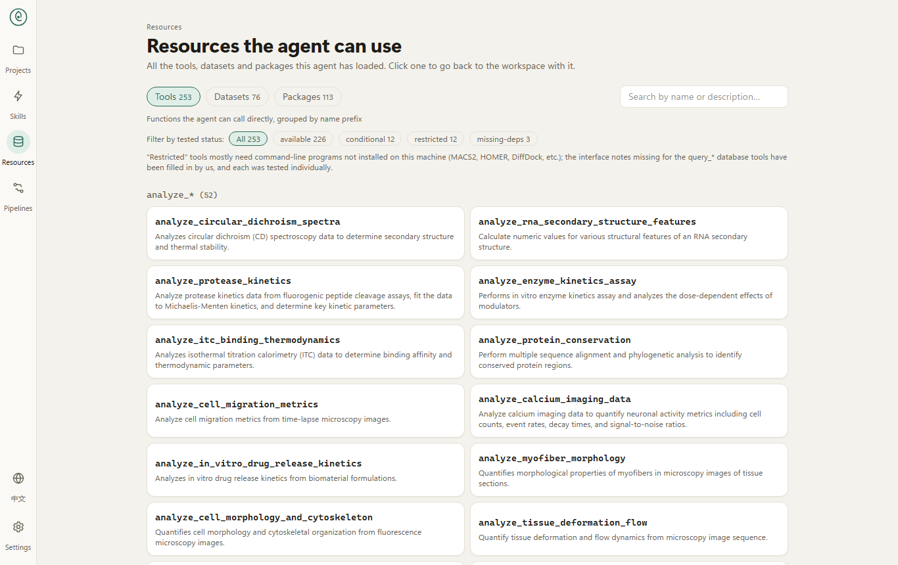

# Biomni-Desk

**A local, bilingual research assistant for biomedicine.** Ask a question in plain language. The agent plans the work, queries public databases and papers, runs analysis code, and answers with the sources it actually read. Everything runs on your own computer.


- **Plan first.** Complex tasks show their plan and wait for your approval.
- **Every step is visible.** The activity log lists each search, database call and code step.
- **Sources you can check.** Each answer lists the pages and records it used.
- **98 skills and about 225 tools.** Step-by-step manuals for common analyses, and bundled tools for databases, literature and analysis.
- **Your data stays with you.** Conversations, results and keys are stored on your computer.

**Read the illustrated guide: [docs/GUIDE.md](docs/GUIDE.md)** · Skills: [docs/SKILLS.md](docs/SKILLS.md) · Tools: [docs/TOOLS.md](docs/TOOLS.md)

---

## Screens

| Plan review for a complex question | A finished answer with sources |
|---|---|
|  |  |

| Skills | Resources |
|---|---|
|  |  |

The interface is available in English and 中文 (switch in the bottom-left corner).

---

## Requirements

- Windows, macOS or Linux
- Python 3.12 (the versions in `requirements.txt` are tested on it)
- Node.js 20 or newer
- A model, either:
  - a **ChatGPT subscription** (you log in inside the app; no separate command-line tool is needed), or
  - an **API key** for an OpenAI-compatible provider, for example [OpenRouter](https://openrouter.ai), DeepSeek or a local model.

## Install

**Windows:** double-click `install.bat`.

**macOS or Linux:**

```bash
./install.sh
```

Pass `--core` (or `-Core` on Windows) to skip the large analysis packages (scanpy, rdkit and others). The first installation takes several minutes.

## Start and stop

**Windows:** double-click `start.bat`. Close the two Biomni-Desk windows to stop.

**macOS or Linux:**

```bash
./start.sh
./stop.sh
```

Then open http://localhost:3001 and wait until the bottom-left corner says *Ready*. The agent takes about a minute to load after start-up.

## First run: set up a model

Until a model is set up, the page says *No model is set up yet*. Then:

1. Open **Settings → Models**.
2. Either click **Log in to ChatGPT** and follow the code shown, or add a provider and paste its API key.
3. Choose the model you want to use.

Keys and the ChatGPT login are stored only on your computer. `.env.example` lists optional environment variables if you prefer to set keys that way.

## Documentation

- [Product guide](docs/GUIDE.md): features, how a task runs, a tour of every page, tools, skills, models, privacy and limits.
- [Skill catalogue](docs/SKILLS.md): all 98 built-in skills, grouped by field.
- [Tool catalogue](docs/TOOLS.md): all bundled tools, grouped by module.

## Limits

- Public databases and literature services sometimes fail or rate-limit. When PubMed is unavailable, the search falls back to Europe PMC and the answer says so.
- Web search can return low-quality pages. Check important results against the primary sources the answer cites.
- Outputs are research aids, not medical advice.
- Some tools need extra software or data on your computer. The **Resources** page shows what is ready.

## Development

- Backend: `biomni_ui/` (FastAPI). Run it with `python -m biomni_ui.server`.
- Web app: `web/` (Next.js). Build with `npm run build` in `web/`.
- Tests: `python -m unittest discover -s biomni_ui -t . -p "test_*.py"`.
- Benchmark: `python -m biomni_ui.evalbench run <label>` runs the fixed questions against a running service.

---

## 简体中文简介

Biomni-Desk 是一个**本地运行的生物医学研究助手**，界面支持中英文切换。你用自然语言提问，智能体会先列出计划（复杂任务需要你确认），再查询公共数据库与文献、运行分析代码，最后给出答案和可核对的来源。对话、结果、设置和密钥都保存在你自己的电脑上。

安装与使用请见上文，图文详解见 [docs/GUIDE.md](docs/GUIDE.md)。

---

## License

Apache-2.0. See `LICENSE`. Biomni-Desk is built on [Biomni](https://github.com/snap-stanford/biomni); the original project's license and attribution are kept.
