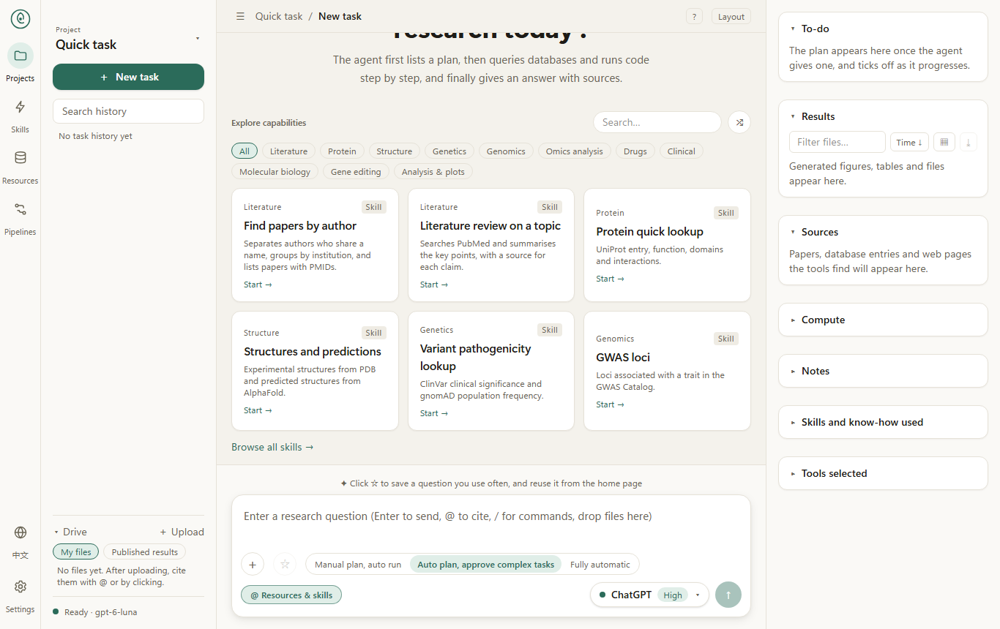
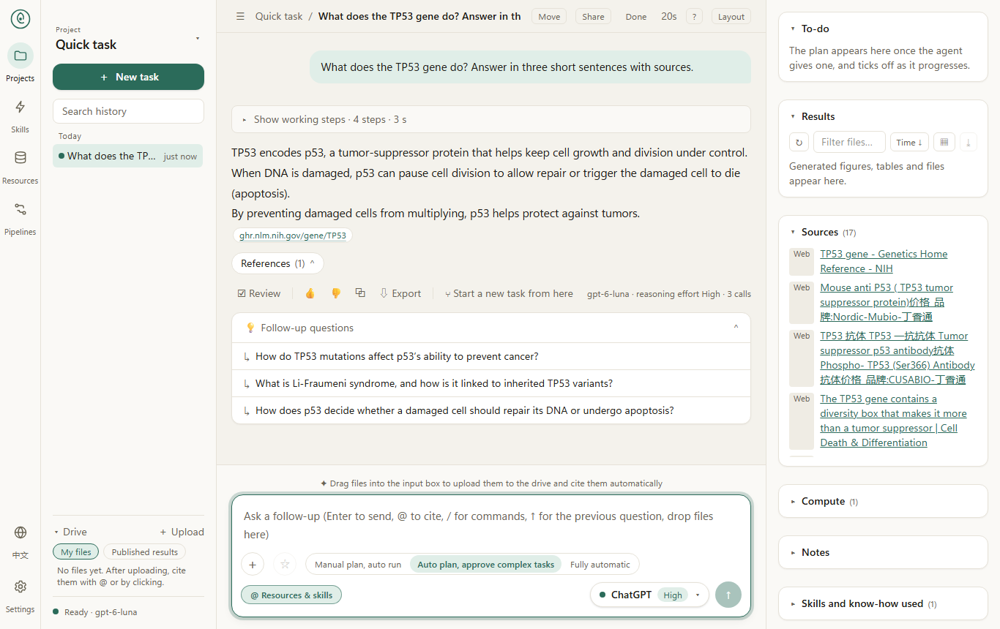
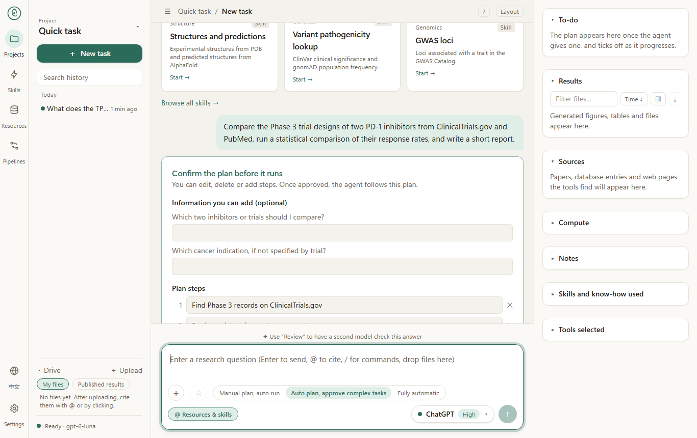
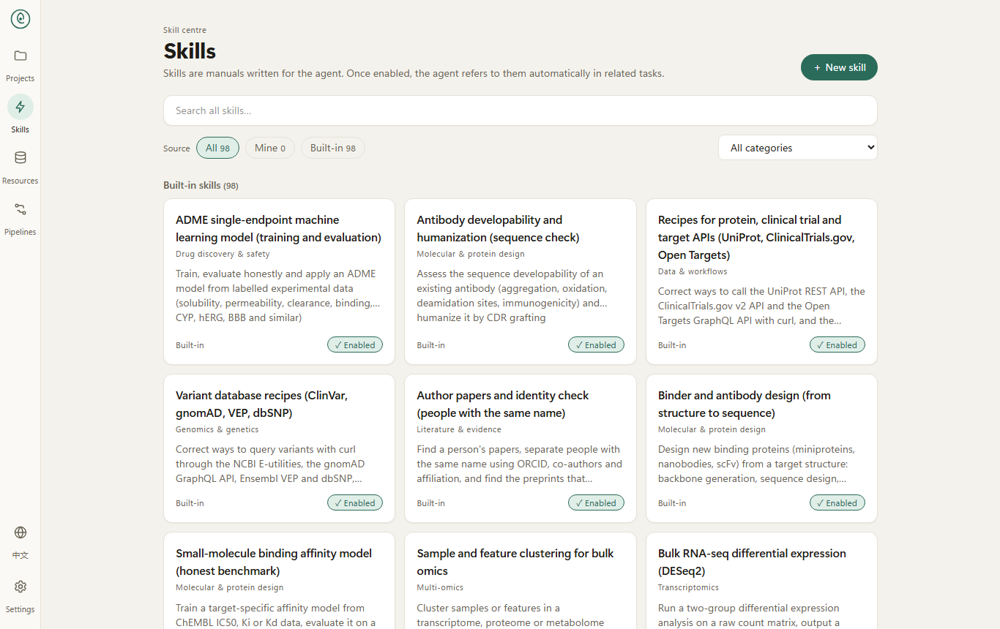

# Biomni-Desk

**English** · [中文](#中文)

**A local, bilingual research assistant for biomedicine.** Ask a question in plain language. The agent plans the work, queries public databases and papers, runs analysis code, and answers with the sources it actually read. It runs on your own computer, and your conversations, results and keys stay there.

- **Plan first.** Complex tasks show their plan and wait for your approval.
- **Sub-agents that work side by side.** Independent parts of a question run as sub-agents at the same time (up to a limit you set), while the main agent keeps working. Each sub-agent appears as its own card with its steps.
- **Continue after a stop or a restart.** A task cut short keeps the work it had done; send "continue" in the same conversation to pick it up.
- **Projects that remember.** Each project keeps a record of what its finished tasks did, and later tasks in that project get the relevant parts, even in a new conversation. You can also save notes for all projects or one project, and switch memory off per project.
- **A community hub.** Search an index of community skills (about 950 from three GitHub sources) and curated tools, databases and software. Every skill is scanned before it is added; risky ones need your confirmation, and dangerous ones are never installed.
- **Save a finished task as a skill.** Under an answer, a draft of its method becomes a reusable skill, which you review before it is saved.
- **Choose the models for each job.** Pick the model and thinking strength for planning, sub-agents, the reviewer and pictures, separately from the main model.
- **Sources you can check.** Each answer lists the pages and records it used.
- **98 built-in skills and many bundled tools** for databases (including Ensembl, PDB, AlphaFold DB, PubChem, OpenAlex and DGIdb), literature and analysis (see the [skill catalogue](docs/SKILLS.md) and the [tool catalogue](docs/TOOLS.md)).
- **English and 中文** interface, switch in the bottom-left corner.

**Documentation:** [product guide](docs/GUIDE.md) · [skills](docs/SKILLS.md) · [tools](docs/TOOLS.md) · [version notes](CHANGELOG.md)

### Screenshots

| Home | A finished answer with sources |
|---|---|
|  |  |

| Plan review | Skills |
|---|---|
|  |  |

### Requirements

- Windows, macOS or Linux
- Python 3.12 (the versions in `requirements.txt` are tested on it)
- Node.js 20 or newer
- A model, either:
  - a **ChatGPT subscription** (log in inside the app; no separate command-line tool is needed), or
  - an **API key** for an OpenAI-compatible provider, for example [OpenRouter](https://openrouter.ai), DeepSeek or a local model.

### Install and start

**Windows:** double-click `install.bat`, then `start.bat`. Close the two Biomni-Desk windows to stop.

**macOS or Linux:**

```bash
./install.sh
./start.sh
./stop.sh
```

Pass `--core` (or `-Core` on Windows) to skip the large analysis packages (scanpy, rdkit and others). The first installation takes several minutes.

Then open http://localhost:3001 and wait until the bottom-left corner says *Ready*. The agent takes about a minute to load after start-up.

### First run: set up a model

1. Open **Settings → Models**.
2. Either click **Log in to ChatGPT** and follow the code shown, or add a provider and paste its API key.
3. Choose the model you want to use. Under **Settings → Helper models** you can choose separate models for planning, sub-agents, the reviewer and pictures.

Keys and the ChatGPT login are stored only on your computer. `.env.example` lists optional environment variables.

### Limits

- Public databases and literature services sometimes fail or rate-limit. When PubMed is unavailable, the search falls back to Europe PMC and the answer says so.
- Web search can return low-quality pages. Check important results against the primary sources the answer cites.
- The community hub lists skills written by others. A passing scan is not a guarantee: read a skill before you rely on it.
- Outputs are research aids, not medical advice.

### Development

- Backend: `biomni_ui/` (FastAPI). Run it with `python -m biomni_ui.server`.
- Web app: `web/` (Next.js). Build with `npm run build` in `web/`.
- Tests: `python -m unittest discover -s biomni_ui -t . -p "test_*.py"`.

### License

Apache-2.0. See `LICENSE`. Biomni-Desk is built on [Biomni](https://github.com/snap-stanford/biomni); the original project's license and attribution are kept.

---

## 中文

**[English](#biomni-desk)** · **中文**

**Biomni-Desk 是一个本地运行的生物医学研究助手。** 你用自然语言提问，智能体会先列出计划，再查询公共数据库与文献、运行分析代码，最后给出答案和它真正读过的来源。它在你自己的电脑上运行，对话、结果、设置和密钥都保存在本机。

- **先计划，再执行。** 复杂任务先展示计划，等你确认。
- **子智能体并行推进。** 问题中相互独立的部分会同时交给子智能体（数量可在设置中调节），主智能体继续做自己的部分。每个子智能体在会话中显示为一张卡片，可展开看它的步骤。
- **中断后可以继续。** 被打断或服务重启的任务会保留已做的工作；在同一对话里发送“继续”即可接着做。
- **项目会记住做过什么。** 每个项目记录已完成任务做过的工作，之后的任务（即使在新对话里）会取到与其相关的部分。你也可以为所有项目或某个项目保存记住的事项，并按项目开关记忆。
- **社区中心。** 搜索社区技能索引（来自三个 GitHub 来源，约 950 个）以及精选的工具、数据库和软件。每个技能添加前都会扫描：有风险的需要你确认，危险的一律不安装。
- **把完成的任务存为技能。** 在答案下方，可把该任务的方法起草成可复用的技能；保存前由你审阅。
- **为每类工作选择模型。** 规划、子智能体、审查和图片可分别选择模型和思考强度，与主模型互不影响。
- **来源可核对。** 每个答案列出它用到的页面和记录。
- **98 个内置技能，以及大量用于数据库（包括 Ensembl、PDB、AlphaFold DB、PubChem、OpenAlex、DGIdb）、文献和分析的工具**（见[技能目录](docs/SKILLS.md)和[工具目录](docs/TOOLS.md)）。
- **界面支持中文和英文**，左下角可切换。

**文档：** [产品指南](docs/GUIDE.md) · [技能](docs/SKILLS.md) · [工具](docs/TOOLS.md) · [版本说明](CHANGELOG.md)

### 截图

| 首页 | 带来源的完整答案 |
|---|---|
|  |  |

| 计划确认 | 技能 |
|---|---|
|  |  |

### 运行要求

- Windows、macOS 或 Linux
- Python 3.12（`requirements.txt` 中的版本已在此版本上测试）
- Node.js 20 或更新版本
- 一种模型：
  - **ChatGPT 订阅**（在应用内登录，不需要另外的命令行工具），或
  - 一个 OpenAI 兼容服务的 **API 密钥**，例如 [OpenRouter](https://openrouter.ai)、DeepSeek 或本地模型。

### 安装与启动

**Windows：** 双击 `install.bat`，然后双击 `start.bat`。关闭两个 Biomni-Desk 窗口即可停止。

**macOS 或 Linux：**

```bash
./install.sh
./start.sh
./stop.sh
```

加上 `--core`（Windows 上为 `-Core`）可跳过体积较大的分析包（scanpy、rdkit 等）。第一次安装需要几分钟。

然后打开 http://localhost:3001，等待左下角显示“就绪”。启动后智能体约需一分钟加载完成。

### 首次使用：设置模型

1. 打开 **设置 → 模型**。
2. 点击 **登录 ChatGPT** 并按提示操作，或添加服务商并粘贴 API 密钥。
3. 选择要用的模型。在 **设置 → 辅助模型** 中，可以为规划、子智能体、审查和图片分别选择模型。

密钥和 ChatGPT 登录信息只保存在你的电脑上。`.env.example` 列出了可选的环境变量。

### 局限

- 公共数据库和文献服务偶尔会失败或限流。PubMed 不可用时，检索会改用 Europe PMC，并在答案中说明。
- 网页搜索可能返回质量不高的页面。重要结果请对照答案引用的一手来源核对。
- 社区中心收录的是他人编写的技能。扫描通过只是一个提示，不是保证：依赖某个技能之前请先阅读它。
- 输出仅供科研参考，不构成医疗建议。

### 开发

- 后端：`biomni_ui/`（FastAPI），运行 `python -m biomni_ui.server`。
- 前端：`web/`（Next.js），在 `web/` 中运行 `npm run build`。
- 测试：`python -m unittest discover -s biomni_ui -t . -p "test_*.py"`。

### 许可证

Apache-2.0，见 `LICENSE`。Biomni-Desk 基于 [Biomni](https://github.com/snap-stanford/biomni) 构建，原项目的许可证和署名均予保留。
