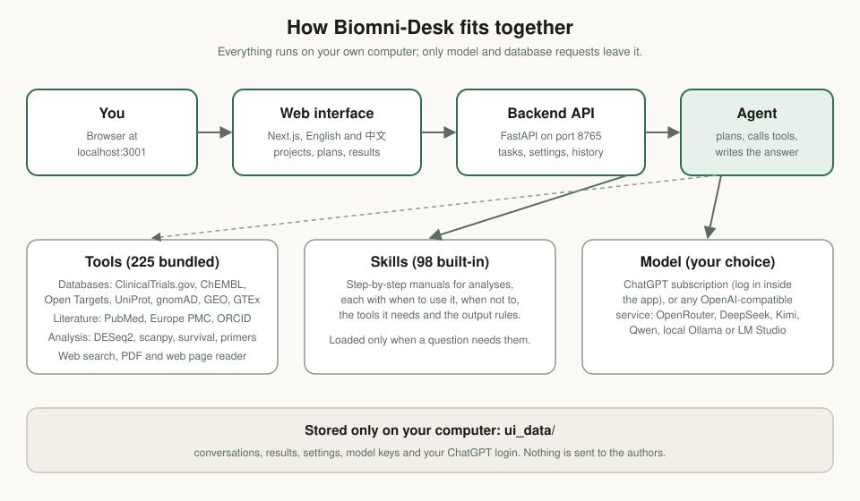
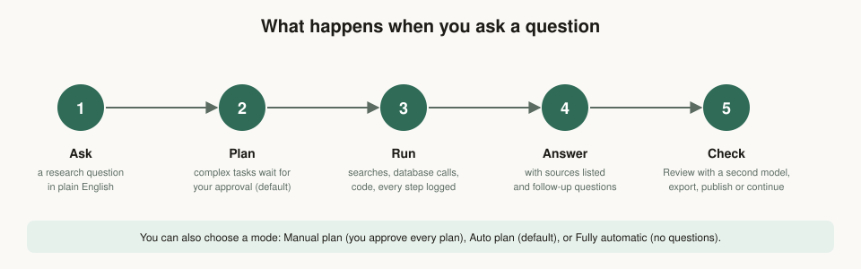

# Biomni-Desk: product guide

Biomni-Desk is a **local, bilingual research assistant for biomedicine**. You ask a question in plain language; the agent makes a plan, queries public databases and papers, runs analysis code, and answers with the sources it actually looked at. Everything runs on your own computer: conversations, results, settings and keys stay in a folder on your machine.


---

## Contents

1. [What it is](#1-what-it-is)
2. [Key features](#2-key-features)
3. [How a task runs](#3-how-a-task-runs)
4. [Tour of the interface](#4-tour-of-the-interface)
5. [Tools](#5-tools)
6. [Skills](#6-skills)
7. [Models and settings](#7-models-and-settings)
8. [Your data and privacy](#8-your-data-and-privacy)
9. [Limits, and how to use answers safely](#9-limits-and-how-to-use-answers-safely)
10. [Install and run](#10-install-and-run)
11. [For developers](#11-for-developers)

---

## 1. What it is

Biomedical questions usually need several sources: a gene's function in UniProt, its disease links in Open Targets, the trials in ClinicalTrials.gov, the papers in PubMed, and a calculation on top. Biomni-Desk does this work inside one conversation:

- it **plans** the steps, and for complex tasks waits for your approval;
- it **calls tools** (about 225 bundled tools, plus web search, PDF reading and a Python kernel);
- it follows **skills**, written manuals for common analyses that tell it what to do and what to check;
- it **answers** with sources, and you can ask it to **review** the answer with a second model.



---

## 2. Key features

| Feature | What it means for you |
|---|---|
| **Plan before you run** | In the default mode, a complex task shows its plan (with clarifying questions) and waits for your approval. You can edit, add or remove steps. |
| **Every step is visible** | The activity log lists each search, database call and code step as it happens, with the time it took. |
| **Sources you can check** | The answer lists the pages and records it used; the *Sources* panel links every source. |
| **Second opinion** | *Review* asks a second model to check the answer. |
| **Follow-up questions** | After each answer the app suggests three questions you are likely to ask next. |
| **Projects and history** | Conversations are grouped by project and kept in the history sidebar. Rename, pin or delete them. |
| **Remember** | Start a message with `Remember: …` and the agent keeps that instruction for later tasks. Manage the list in Settings. |
| **98 skills** | Step-by-step manuals for analyses from literature review to single-cell, pharmacology and statistics. See [docs/SKILLS.md](SKILLS.md). |
| **225 bundled tools** | Databases, literature services, analysis functions and utilities. See [docs/TOOLS.md](TOOLS.md). |
| **Reports and charts** | Turns results into charts, a report with a check table and sources, or a slide deck. |
| **Pipelines** | A catalogue of nf-core pipelines (Nextflow), with help to set one up and check it before a run. |
| **English and 中文** | The whole interface switches language from the bottom-left corner. The agent answers in the language of your question. |
| **Local first** | Your data stays on your computer. Only model requests and database queries leave it. |

---

## 3. How a task runs



**1. Ask.** Type a question in the box at the bottom. Press Enter to send. You can cite skills, tools, datasets or your own files with `@`, type `/` for commands (plan, new task, review, layout), and drop files into the box to upload them.

**2. Plan.** A simple question runs directly. A complex one shows *Confirm the plan before it runs*: the clarifying questions the agent needs answered, the numbered steps, and three buttons: *Approve and run*, *Skip the plan and run directly*, and *Cancel*.


**3. Run.** The agent works through the steps. *Show working steps* expands the log of every tool call. Figures, tables and files it produces appear in the *Results* panel on the right.

**4. Answer.** The answer appears with its references, the *Sources* panel (every page and record the agent read), and three follow-up questions.


The sources panel lists everything the agent read, including low-quality pages. Read the answer together with the sources, and check the important numbers in the primary records.

**5. Check and reuse.** Use *Review* for a second model's check, *Export* to copy the answer as text or print it to PDF, or *Start a new task from here* to continue from that point.

### Modes

The mode switch sits above the question box:

| Mode | What happens |
|---|---|
| **Manual plan, auto run** | Every task shows its plan for approval first. |
| **Auto plan, approve complex tasks** (default) | Simple questions run at once. Complex tasks show their plan for approval; the agent asks when it is unsure. |
| **Fully automatic** | No plan and no questions; the agent decides and runs. |

---

## 4. Tour of the interface

### Home and projects

The home page has *Explore capabilities*: cards for common tasks that start a well-formed question, filterable by field (literature, protein, structure, genetics, genomics, omics analysis, drugs, clinical, molecular biology, gene editing, analysis and plots). *Recent tasks* lists your last questions. The left column shows the current **project** (the default is *Quick task*), your history, and your **Drive**: files you upload and results you publish.


The **中文** button at the bottom-left switches the whole interface to Chinese; the agent still answers in the language of each question.


### The history sidebar

Every conversation is listed by date. Search, double-click a title to rename it, or open *More actions* to pin, rename or delete it.


### Results, to-do and sources

While a task runs, the right-hand panels fill in: **To-do** shows the plan and ticks steps off as they finish; **Results** lists generated figures, tables and files (filter by name, sort by time); **Sources** lists the papers, database entries and web pages used; **Compute**, **Notes** and **Skills and know-how used** show what ran and which manuals guided it. The **Layout** button in the top bar hides or shows them.

### Skills

The Skills page lists the built-in manuals and any you write yourself. Filter by source (all, mine, built-in) or by category, search by name, enable or disable a skill, and use **+ New skill** to add one. Enabled skills are used automatically when a question needs them.


### Resources

Resources shows what the agent can use on this computer: **Tools** (with their tested status: available, conditional, restricted or missing dependencies), **Datasets** and **Packages**. The status tells you when a tool needs software that is not installed, so you know why it cannot run.


### Pipelines

The Pipelines page is for analyses you want to repeat. It offers:

- **Start from an analysis**: turn a finished analysis or notebook into a reproducible pipeline;
- **Create a reusable module**: wrap one tool or step as a module;
- **Check before running**: check a pipeline for problems before you run it on a cluster;
- an **nf-core catalogue** (fetchngs, rnaseq, sarek, scrnaseq, chipseq and more). Pipelines run on your own computer and need Nextflow and Docker or Conda; the agent checks these first and says what to install.


### Settings

Settings is grouped into Account (Profile), Workspace (Personalisation, Projects, Models, Agent, Remember and database, Usage) and Data (Connections, Data and privacy). Models and providers are described in [section 7](#7-models-and-settings).


---

## 5. Tools

The agent does not guess what a database contains: it calls the tool and reads what comes back. Tools fall into these groups. The full list, with each tool's own description, is in [docs/TOOLS.md](TOOLS.md).

| Group | Examples | Typical use |
|---|---|---|
| **Gene, protein and variant databases** | UniProt lookup, Ensembl, ClinVar, gnomAD constraint, GTEx tissue expression, STRING and Reactome interactions, CIViC cancer variants, ENA runs | "What does this gene do, where is it expressed, how tolerant is it to loss of function?" |
| **Drug and clinical data** | ChEMBL target compounds, Open Targets (disease links and druggability), openFDA adverse events, ClinicalTrials.gov registrations | "Which compounds target this protein, what does the trial pipeline look like?" |
| **Expression and omics** | GEO dataset search, scanpy basics, DESeq2 differential expression, pathway enrichment | "Which genes change between these groups, and what pathways do they belong to?" |
| **Analysis functions** | survival with Kaplan–Meier and Cox, meta-analysis, power and sample size, primer design, molecule properties, plate layout | Calculations you would otherwise do by hand in a spreadsheet. |
| **Literature** | PubMed search, Europe PMC (including preprints), Crossref, OpenAlex, ORCID, Zenodo, abstracts, author paper lists with name disambiguation | "What has been published on X, and what did this author publish?" |
| **Web and documents** | web search, read a web page, read a PDF | Reading the sources the answer depends on. |
| **Reports and figures** | make chart, build report (with check table and sources), make slide deck | Turning results into a deliverable. |
| **Code** | a Python kernel the agent uses step by step, with its variables kept between steps | Analysis that is too specific for a ready-made function. |
| **ToolUniverse** | search and run tools from the ToolUniverse catalogue | Less common databases and services. |

Some tools need something on your computer, such as an R package, a command-line program or a file. The **Resources** page shows which tools are ready; the agent explains what is missing rather than failing silently.

---

## 6. Skills

A skill is a manual the agent reads before it works on a kind of question. Each one says **when to use it**, **when not to**, **which tools it relies on**, **the steps**, **the quality checks**, and **the output it should produce**.

There are 98 built-in skills in 15 categories:

| Category | Skills | Examples |
|---|---|---|
| Transcriptomics | 19 | bulk RNA-seq differential expression with DESeq2; co-expression networks; deconvolution of bulk tissue |
| Drug discovery & safety | 18 | target assessment; druggability; ADME modelling; off-target safety; drug repurposing; PK/PD models; pharmacovigilance signals |
| Genomics & genetics | 14 | GWAS fine-mapping; Mendelian randomisation; variant annotation; polygenic risk scores; rare-disease gene ranking |
| Data & workflows | 10 | correct ways to call UniProt, ClinicalTrials.gov and Open Targets APIs; parallel queries; pipeline validation and module authoring; public dataset search |
| Molecular & protein design | 9 | antibody developability and humanisation; binder design; binding-affinity models; sgRNA design |
| Multi-omics | 7 | bulk omics clustering; MOFA-style integration; disease progression trajectories |
| Literature & evidence | 6 | literature review; author papers with identity checks; preclinical evidence; meta-analysis |
| Epigenomics | 4 | ChIP-Atlas target genes and enrichment; ATAC and multiome analysis |
| Experimental design | 3 | sample size and power; plate layout; trial design simulation |
| Clinical & statistics | 2 | survival analysis; trial registration landscape |
| Proteomics & cytometry | 2 | mass-spectrometry proteomics; flow cytometry FCS files |
| Single-cell | 1 | scanpy core analysis |
| Microbiome | 1 | 16S two-group analysis |
| Reports | 1 | report with charts and a check table |
| General | 1 | how to write a new skill |

The full table, with what each skill does and when to use it, is in [docs/SKILLS.md](SKILLS.md). You can write your own skills on the Skills page, in the same format.

---

## 7. Models and settings

Biomni-Desk does not come with a model. You choose one:

**ChatGPT subscription.** Open **Settings → Models**, click **Log in to ChatGPT** and follow the code shown there. No separate command-line tool is needed. The app uses the membership's model (gpt-6-luna), with reasoning effort set to Medium, High or Extra high.

**OpenAI-compatible providers.** Click **Add provider**, choose a preset or choose *Other* and enter an address, then paste the key. Presets include DeepSeek, Kimi (Moonshot), Zhipu GLM, Qwen (Alibaba Cloud Bailian), SiliconFlow, MiniMax, Volcano Engine Ark, Groq, Together AI, Mistral, Anthropic, Google Gemini, xAI, and local models through Ollama or LM Studio. For OpenRouter, use *Other* with the address `https://openrouter.ai/api/v1`. Each provider has **Test connection**, which checks the key and the address.

Keys are stored only on your computer and sent only to the provider you configured. The Settings page never shows a key after you save it.


**First run.** Until a model is set up, the page says *No model is set up yet*, and the question box is disabled. This is intentional: the app will not try a model it cannot reach.

---

## 8. Your data and privacy

- Conversations, results, settings, provider keys and the ChatGPT login are stored in the `ui_data/` folder of the application, on your computer.
- Questions and search queries go to the model provider you chose and to the public databases the tools query (ClinicalTrials.gov, PubMed and so on).
- The authors do not receive your data. The public release does not contain anyone's conversations, results or keys.
- **Data and privacy** in Settings lets you review what is stored and clear it.

---

## 9. Limits, and how to use answers safely

- **Check the numbers.** Results are only as good as the sources they reached. Verify the important figures in the primary record (the paper, the registry entry, the database page).
- **Read the sources panel.** Web search returns some low-quality pages (for example shopping pages); the answer may still cite one. Trust the primary sources over secondary ones.
- **Not medical advice.** Variant, clinical and trial outputs summarise public records. They do not replace a clinical or genetic-counselling judgement.
- **Public services fail.** Databases and literature services sometimes time out or rate-limit. When PubMed is unavailable the search falls back to Europe PMC and the answer says so.
- **Some tools need extra software or files.** Examples: R packages, command-line tools such as MACS2 or DiffDock, and datasets that are fetched on demand. The Resources page shows what is ready.
- **Model quality matters.** The agent's reasoning is only as strong as the model you choose. Try *Review* for an independent check of important answers.

---

## 10. Install and run

The short version (full details in the [README](../README.md)):

**Windows:** double-click `install.bat`, then `start.bat`.
**macOS or Linux:** run `./install.sh`, then `./start.sh`.

Open http://localhost:3001 and wait for *Ready* in the bottom-left corner. The first installation takes several minutes, because it installs the Python packages and builds the web page.

Requirements: Windows, macOS or Linux; Python 3.12; Node.js 20 or newer; and either a ChatGPT subscription or an API key from an OpenAI-compatible provider.

---

## 11. For developers

| Path | What it holds |
|---|---|
| `biomni_ui/` | The backend: API (`server.py`), the agent runner and its tools (`runner.py`, `native_agent.py`, `dbtools.py`, `analysis.py`, `lit.py`, `web.py`), the skill loader and the 98 built-in skills (`builtin_skills/`). |
| `biomni/` | The core tool library, the tool registry and the LLM adapters. |
| `web/` | The web interface (Next.js): pages in `src/app/`, components in `src/components/`, translations in `src/lib/messages/zh.ts`. |
| `docs/` | This guide, the skill and tool catalogues, and the screenshots. |
| `scripts/` | Helper shell scripts (for example running a tool, saving an image). |

Useful commands:

```bash
python -m biomni_ui.server                                       # start the backend (port 8765)
cd web && npm run build && npm run start -- -p 3001              # build and start the web interface
python -m unittest discover -s biomni_ui -t . -p "test_*.py"     # run the test suite
python -m biomni_ui.evalbench run <label>                        # run the fixed benchmark questions
```

The skill catalogue ([SKILLS.md](SKILLS.md)) and the tool catalogue ([TOOLS.md](TOOLS.md)) are generated from the code and the skill files, so they stay in step with the product.
